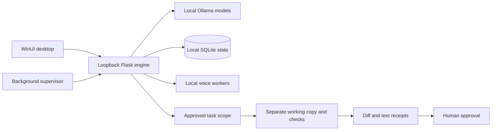

# Nova Native

A Windows personal-assistant prototype with a native WinUI interface, local-model
inference, voice interaction, persistent project memory, and approval-based tasks.
This repository is a privacy-cleaned portfolio source snapshot of version 1.0.8.

## What it demonstrates

- A C# / WinUI desktop interface with responsive panels and an animated voice orb.
- A Python / Flask engine with streaming chat and local Ollama model selection.
- Separate message dictation and conversational voice, including Windows echo cancellation.
- SQLite-backed preferences, projects, responsibilities, task receipts, and recovery.
- Scoped candidate fixes: capture approved files, prepare a working copy, record checks,
  and require approval of the exact revision before changing source files.
- A background supervisor, task controls, an inbox, and optional Windows notifications.
- Optional local image/video generation through ComfyUI and a separate iMessage bridge.



## Repository layout

| Location | Purpose |
| --- | --- |
| `NovaNative/` | WinUI interface, voice lifecycle, and native AEC source |
| `engine/` | Chat, tools, local memory, scheduling, responsibilities, and candidate fixes |
| `photon/` | Optional direct-message bridge and allowlist tests |
| `tests/` | Isolated regressions using temporary state and mocked model responses |
| `scripts/` | Source checks, test runner, and allowlisted source export |
| `docs/` | Setup, safety boundaries, and publication review |

## Build and run

The native project targets .NET 10 and Windows SDK 10.0.26100.0. Build on x64 Windows
with the .NET 10 SDK and Visual Studio C++ desktop tools. Python 3.14 was used for
the host checks; the optional Pipecat worker uses a separate Python 3.11 environment.
NuGet dependencies and npm versions are recorded in the project and package files.

1. Create a Python environment and install `requirements.txt`.
2. Install Ollama separately and download a model suited to your hardware. A small
   model can be useful for initial setup; inference performance is hardware-dependent.
3. In an x64 Visual Studio developer shell, run `NovaNative/native-aec/Build AEC.ps1`.
4. Publish the app:

   ```powershell
   dotnet publish NovaNative/NovaNative.csproj -c Release -r win-x64 -p:Platform=x64 -o app
   ```

5. Set `NOVA_PYTHON` to the full path of your environment's Python executable.
6. Run the installer only when you intend to create or update your own installation:

   ```powershell
   & '.\Install Nova Native.ps1'
   ```

Fresh installations create fresh state. Importing an existing Nova database is an
explicit choice through `-MigrateFrom`; no previous user's history is bundled.
Only one Native installation should use the default port 5100 at a time.

Voice models, optional workers, ComfyUI, media weights, account sign-ins, and the
Photon project are separate setup steps. See [setup notes](docs/SETUP.md).

## Run source checks

```powershell
python -m pip install -r requirements-test.txt
python scripts/check_public_source.py
python scripts/run_checks.py
node --test photon/bridge.test.mjs
```

These tests use temporary data and mocked model calls. They do not send messages,
record a microphone, make purchases, or run the installed assistant. Native AEC
tests require your locally compiled DLL and are a separate opt-in check.

## Boundaries and current limitations

This is a personal Windows application, not a hardened multi-user server. Keep its
HTTP and voice services on loopback. Optional file, command, web, and computer
capabilities start off in this public template. Review permissions before enabling
them. Python audit guards and working copies are not operating-system sandboxes.
Passing a syntax check or receiving a model response does not prove a goal is done.
Task application changes source files; deployment remains a separate operation.
Background work requires the PC to remain awake.

The original installation's pinned Native-build demonstration archive is not
published. The public task editor offers guarded Python checks; the host's optional
registered-build mechanism requires separately reviewed local inputs.

## Publication and license

Private state, credentials, models, backups, cached workspaces, compiled dependencies,
and personal screenshots are excluded. [Publication review](docs/PUBLICATION_REVIEW.md)
records the checks and the adjustments made only in this copy.

No project reuse license has been selected. Dependencies and externally downloaded
models retain their own license terms; they are not relicensed by this repository.
See [third-party notes](THIRD_PARTY_NOTICES.md). Choose a project license explicitly
before granting others reuse rights; GitHub explains the options in its
[licensing documentation](https://docs.github.com/en/repositories/managing-your-repositorys-settings-and-features/customizing-your-repository/licensing-a-repository).
